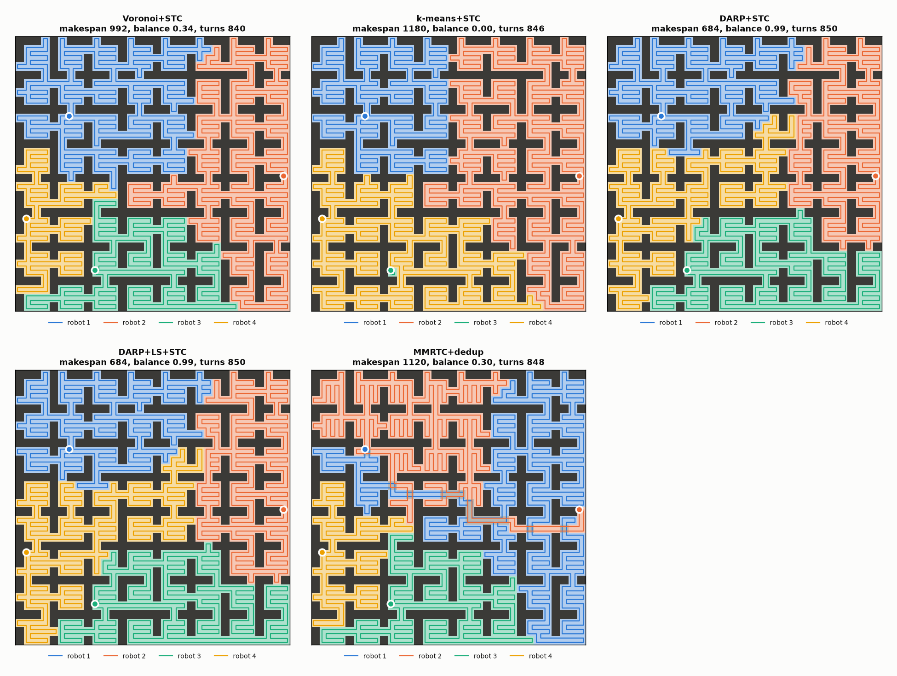

# Multi-robot Complete Coverage Path Planning: DARP + STC and Min-max Tree Cover

**Advanced Algorithms, course project, Topic 11**
*Multi-robot CCPP: area partitioning + Spanning Tree Coverage, and min-max rooted tree cover.*

`k` robots must jointly cover every free cell of a grid map while minimising
the **makespan** (the time until the last robot finishes). This repository
contains from-scratch Python implementations of:

| component | file | role |
|---|---|---|
| **DARP** (Kapoutsis et al., JIRS 2017) | `mcpp/darp.py` | main partitioning method |
| **STC** (Gabriely & Rimon, AMAI 2001) | `mcpp/stc.py` | single-robot coverage tour of each region |
| Geodesic **Voronoi** partition | `mcpp/partition.py` | baseline (required) |
| **k-means** partition + connectivity repair | `mcpp/partition.py` | baseline (required) |
| **Min-max rooted tree cover**, 4-approximation (Even et al., ORL 2004) + deduplication | `mcpp/mmrtc.py` | tree-cover branch |
| **Min-max local search** (transfer chains) | `mcpp/local_search.py` | extension: improves any partition |
| Heterogeneous robots (speed-proportional shares, speed-aware LS) | `darp.py`, `local_search.py` | extension |
| Turn-reducing comb spanning trees (TMSTC*-inspired) | `mcpp/stc.py` | extension / ablation |
| **Exact MIP** (min-max connected partition and tree cover, HiGHS) | `mcpp/mip.py` | optimality gap |
| Metrics, plots, animations | `mcpp/metrics.py`, `mcpp/viz.py` | evaluation |

How this maps to the assignment:

* **Minimum requirement (all done):**
  * DARP + STC, plus Voronoi and k-means baselines.
  * k = 2..8 robots on 6 MovingAI maps (≥ 3 required).
  * Reported metrics: makespan, total length, load balance, coverage, turns,
    runtime, overlap and remaining conflicts.
* **Analysis (Section 3.2):** see [`docs/analysis.md`](docs/analysis.md). It covers:
  * formal definition and NP-hardness
  * pseudocode and invariants
  * guarantees
  * a complexity table
* **Experiments:** see [`results/REPORT.md`](results/REPORT.md), generated by the scripts. It contains:
  * main benchmark
  * log–log scaling and profiling
  * ablations
  * optimality gap vs MIP
  * Wilcoxon tests
* **Extensions (bonus):**
  * local search
  * MMRTC with a certified lower bound
  * heterogeneous teams
  * turn-aware trees

---

## 1. Quick start

Requires **Python ≥ 3.10** (developed with 3.14).

```bash
python -m venv .venv
# Windows: .venv\Scripts\activate     Linux/macOS: source .venv/bin/activate
pip install -r requirements.txt

python -m pytest                       # 215 unit tests, ~5 s
python demo.py                         # room-32-32-4, k = 4, all main methods
python demo.py --map maze-32-32-4.map --k 6 --methods darp darp_ls --gif
```

`demo.py` prints a metric table, writes a side-by-side figure to
`results/demo/`, and with `--gif` writes an animation of the synchronised
execution (useful for the video).



## 2. Reproducing all results

All randomness is seeded. Start positions are derived from
`(scenario_seed, map, k, scenario)`, and the algorithms' seeds are the run
indices.

```bash
cd experiments
python run_main.py --config ../configs/quick.json   # smoke test, ~15 s
python run_main.py --config ../configs/main.json    # main benchmark
python run_ablation.py                              # tuning-set ablations
python run_optgap.py                                # MIP optimality gap
python run_scaling.py                               # log-log runtime, profile, memory (single process)
python analyze.py                                   # -> results/REPORT.md + results/figures/*.png
```

Wall-clock times on the reference machine (16 logical cores, 14 worker
processes) are stored in each `results/*/env.json`. Hardware and library
versions are logged there automatically, as required by Section 3.3 of the
assignment.

**Instance sets.** Parameters are tuned on a separate set, and results are
reported on a different one.

| set | maps | used by |
|---|---|---|
| *report* | MovingAI `empty-32-32`, `random-32-32-10`, `room-32-32-4`, `maze-32-32-4`, `room-64-64-8`, `den312d`; 5 seeded start scenarios per (map, k) | `run_main.py` |
| *tuning* | generated open / rooms / maze / random maps with their own seeds | `run_ablation.py` (all parameter choices) |
| *small* | generated 36–64-cell maps | `run_optgap.py` (exact MIP) |

The MovingAI maps (Sturtevant 2012) are included in `data/movingai/`.
`scripts/download_movingai.py` re-downloads them.

**Map resolution.** By default each MovingAI cell is interpreted as one
*coarse* STC cell, i.e. 2×2 robot footprints. This is the usual DARP-STC
convention, and no free cell is lost. `mode: "fine"` in a config (or
`demo.py --fine`) treats each map cell as one robot footprint instead. In
that case partially blocked 2×2 blocks cannot be covered by STC.
`REPORT.md` §5 quantifies that loss.

## 3. Methods in one paragraph each

* **STC.**
  * Builds a spanning tree on the coarse cells of a region.
  * Circumnavigates it on the fine grid. We implement this as *cycle
    merging*: one 4-cycle per coarse cell, merged across every tree edge.
  * The result is a closed tour of exactly `4|V|` moves that visits every
    fine cell once.
  * The tree shape only affects the number of turns. `adaptive` tries a
    horizontal and a vertical comb tree and keeps the one with fewer turns.
* **DARP.**
  * Each robot has an evaluation matrix (distance from its start). Each cell
    goes to the robot with the smallest value.
  * Over-loaded robots' matrices are scaled up and under-loaded ones down:
    `m_i = 1 + c (k_i - f_i)/f_i`.
  * A connectivity term pulls cut-off fragments back to the robot's
    component.
  * The loop stops when all regions are connected and within `thr` cells of
    the fair share.
  * Updates are applied in the log domain (no overflow). On failure, the best
    connected assignment seen is returned, so the output is always a valid
    partition.
* **Voronoi / k-means.**
  * Voronoi: multi-source BFS (geodesic Voronoi).
  * k-means: Lloyd's algorithm seeded at the robot starts, followed by a
    repair step. The repair keeps each robot's start component and re-grows
    the orphan cells by BFS.
* **Local search.**
  * Repeatedly moves one cell along a chain of adjacent regions, from a
    maximum region to a region that can absorb it.
  * Uses Tarjan articulation points to keep every region connected.
  * The potential `Σ s_i²` strictly decreases, so the search terminates.
* **MMRTC (Even et al.).**
  * Guesses a bound `B`, computes the root-contracted spanning tree and cuts
    it into pieces of weight in `[B, 2B)`.
  * Matches pieces to roots within distance `B` (Kuhn's algorithm) and
    binary-searches `B`.
  * Every tree weighs `< 4B ≤ 4·OPT`. `4(B+1)` is a certified lower bound.
  * `mmrtc_dedup` removes doubly covered cells where possible.
* **MIP.**
  * Single-commodity-flow formulation per robot, solved with HiGHS via
    `scipy.optimize.milp`.
  * `cover=False` gives the optimal partition (the optimum of every
    partition+STC method). `cover=True` gives the optimal tree cover.

## 4. Metrics

| metric | definition |
|---|---|
| makespan | `max_i L_i`: moves of the longest closed tour (one move = one time step) |
| lower bound | `4·ceil(n/k)`: each move visits at most one new fine cell |
| total length | `Σ_i L_i` |
| balance / CV | `min L / max L`; `std(L)/mean(L)` |
| coverage | covered free fine cells / all free fine cells |
| overlap | redundant visits / covered cells (non-zero only for tree covers) |
| turns | heading changes along the tours (a U-turn counts 2) |
| time makespan | `max_i (L_i + 0.5·turns_i) / v_i` (turn-aware completion time) |
| conflicts | vertex + swap conflicts under synchronous execution |
| runtime | partition time + STC time (wall clock) |

## 5. Results

The full tables, statistical tests and figures are in
[`results/REPORT.md`](results/REPORT.md).

RESULTS_SUMMARY_PLACEHOLDER

## 6. Repository layout

```
mcpp/                 core library (all algorithms written for this project)
  grid.py             maps, 2x2 coarse decomposition, MovingAI loader, generators
  graph.py            BFS, Voronoi labels, Tarjan articulation points, union-find
  stc.py              spanning trees (BFS/DFS/Kruskal) + STC cycle-merging tour, turn counting
  darp.py             DARP
  partition.py        Voronoi, k-means, connectivity repair, validation
  local_search.py     min-max transfer-chain local search (extension)
  mmrtc.py            Even et al. 4-approximation + deduplication
  mip.py              exact MIP models (HiGHS)
  metrics.py          makespan, balance, coverage, overlap, turns, conflicts
  planner.py          end-to-end pipeline used by demos and experiments
  viz.py              figures and GIF animations
experiments/          run_main / run_ablation / run_optgap / run_scaling / analyze
configs/              experiment configurations (main.json, quick.json)
data/movingai/        benchmark maps (MovingAI)
docs/analysis.md      theoretical analysis (6 mandatory points)
results/              CSV outputs, REPORT.md, figures
tests/                unit tests (pytest)
```

## 7. Academic integrity, attribution and AI-use declaration

This project follows the rules in Sections 5.3, 5.4 and 7.1 of the
assignment.

* **Core algorithms are our own implementation.** DARP, STC, the Voronoi and
  k-means partitioners, the connectivity repair, the local search, the Even
  et al. tree-cover approximation, the MIP models, the articulation-point
  and union-find structures, and all metrics were written for this project
  from the papers' descriptions.
* **Author code was used only for cross-checking.** The DARP authors'
  repository (github.com/alice-st/DARP) was consulted once, to check how
  the original implementation handles the connectivity term and threshold
  relaxation. No code was copied. Our update rule deliberately differs (see
  the `mcpp/darp.py` docstring). LS-MCPP (github.com/reso1/LS-MCPP) and
  TMSTC* (github.com/CourierLo/TMSTC-Star) were not used as code.
* **Third-party infrastructure** (allowed by Section 5.3):
  * NumPy for arrays.
  * SciPy for connected-component labelling, Euclidean distance transform,
    the Hungarian algorithm (only in the k-means++ reference variant),
    HiGHS MIP solving via `scipy.optimize.milp`, and the Wilcoxon test.
  * Matplotlib and Pillow for figures.
* **Data.** MovingAI MAPF benchmark maps, N. Sturtevant, *Benchmarks for
  Grid-Based Pathfinding*, IEEE TCIAIG 4(2), 2012,
  https://movingai.com/benchmarks/mapf.html.
* **AI-tool declaration.** An AI coding assistant (Claude Code, Anthropic)
  was used to help write and debug code, tests and documentation. All team
  members must review, understand and be able to explain the code, proofs
  and complexity analyses of the parts they present (Section 5.4). Declare
  the tool and its scope in the report's appendix.
* **Independence.** Results in `results/` were produced by the scripts in
  this repository on our own machine. Other groups working on the same topic
  must produce their own code and results.

> **Team TODO before submission** (Sections 5.2 and 6.1):
> * Every member commits their own part from their own Git account.
> * Fill in the contribution table below.
> * Re-run everything from this README on a clean machine.

| member | code (files / functions) | report sections | video part | contribution % |
|---|---|---|---|---|
| _name 1 (leader)_ | | | | |
| _name 2_ | | | | |
| _name 3_ | | | | |
| _name 4_ | | | | |
| _name 5_ | | | | |

## 8. References

1. A. C. Kapoutsis, S. A. Chatzichristofis, E. B. Kosmatopoulos. *DARP: Divide Areas Algorithm for Optimal Multi-Robot Coverage Path Planning.* J. Intelligent & Robotic Systems 86, 2017.
2. Y. Gabriely, E. Rimon. *Spanning-tree based coverage of continuous areas by a mobile robot.* Annals of Mathematics and Artificial Intelligence 31, 2001.
3. G. Even, N. Garg, J. Könemann, R. Ravi, A. Sinha. *Min-max tree covers of graphs.* Operations Research Letters 32, 2004.
4. J. Tang, H. Ma. *Mixed Integer Programming for Time-Optimal Multi-Robot Coverage Path Planning with Efficient Heuristics.* IEEE RA-L, 2023. arXiv:2306.17609.
5. J. Tang, H. Ma. *Large-Scale Multi-Robot Coverage Path Planning on Grids with Path Deconfliction (LS-MCPP).* arXiv:2411.01707.
6. J. Lu et al. *TMSTC\*: A Path Planning Algorithm for Minimizing Turns in Multi-Robot Coverage.* IEEE RA-L, 2023. arXiv:2212.02231.
7. E. M. Arkin, S. P. Fekete, J. S. B. Mitchell. *Approximation algorithms for lawn mowing and milling.* Computational Geometry 17, 2000.
8. M. E. Dyer, A. M. Frieze. *On the complexity of partitioning graphs into connected subgraphs.* Discrete Applied Mathematics 10, 1985.
9. R. E. Tarjan. *Depth-first search and linear graph algorithms.* SIAM J. Computing 1, 1972.
10. N. Sturtevant. *Benchmarks for Grid-Based Pathfinding.* IEEE TCIAIG 4(2), 2012.
